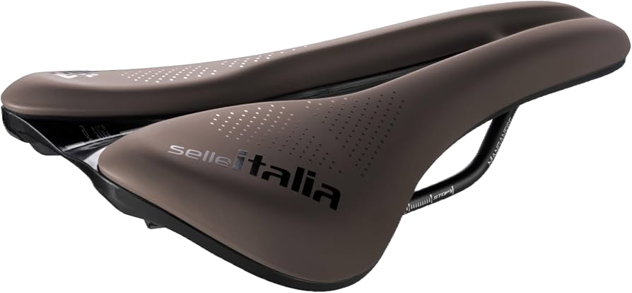

Das Grizl ist mein Alltagsrad. Fast jeden Tag zur Arbeit und zurück, knapp 20 Kilometer, mit Packtasche. Ein Rad, das so oft fährt, muss nicht schön sein. Es muss passen. So wie es aus dem Karton kam, hat es das nicht ganz. Deshalb habe ich an vier Stellen nachgelegt.

## Cockpit: kürzer und schmaler

Als Erstes kam der Lenker. Ab Werk waren 460 Millimeter verbaut, jetzt sind es 420. Danach der Vorbau: von 90 auf 70 Millimeter.

Der Grund war ganz unromantisch: Schmerzen in der linken Hand und in der linken Schulter. Beides zusammen holt den Lenker ein Stück näher an den Körper, und die Hände liegen eher dort, wo die Schultern sind. Weniger Strecken, weniger Druck auf Hand und Schulter. So jedenfalls die Idee.

## Reifen: Terra Competition, tubeless

Die Schwalbe G-One sind runter, drauf sind jetzt Continental Terra Competition in 45 Millimetern, tubeless. Conti hat den Reifen im Februar 2026 vorgestellt und bezeichnet ihn als den schnellsten Gravelreifen der Terra-Reihe. Er ist für Asphalt und festen Schotter gedacht, also genau für den Mix, den man in Bremen zwischen Haustür und Werkstor hat.

Tubeless heißt: kein Schlauch, dafür Dichtmilch im Reifen. Kleine Löcher dichten sich meist selbst ab, und man kann mit etwas weniger Luftdruck fahren. Auf Kopfsteinpflaster merkt man das.

## Sattel: Selle Italia Novus

Zum Schluss der Sattel. Am Grizl sitzt jetzt ein Selle Italia Novus. Kurze Nase, breiter Ausschnitt, für lange Tage auf Schotter gemacht. Auf der Pendelstrecke fallen die Kilometer schnell zusammen, da zählt jeder Zentimeter Sattel.

## Fazit

Nichts davon ist spektakulär. Kein neuer Rahmen, keine neue Schaltung. Aber das Grizl fährt sich jetzt so, wie ich es täglich brauche. Und das neue [Storck](/journal/storck-grix-2/) kann sich um die langen Tage kümmern.
