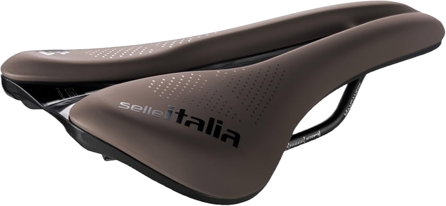

The Grizl is my everyday bike. Almost every day to work and back, just under 20 kilometres, with a pannier. A bike that gets ridden that often doesn't have to be pretty. It has to fit. Straight out of the box it didn't quite. So I made changes in four places.

## Cockpit: shorter and narrower

The handlebar came first. It came with 460 millimetres, now it is 420. Then the stem: from 90 down to 70 millimetres.

The reason was entirely unromantic: pain in my left hand and left shoulder. Together, both changes bring the bar a little closer to the body, and the hands sit more in line with the shoulders. Less reaching, less pressure on hand and shoulder. That's the idea, at least.

## Tyres: Terra Competition, tubeless

The Schwalbe G-One are off, and Continental Terra Competition in 45 millimetres are on, tubeless. Conti introduced the tyre in February 2026 and calls it the fastest gravel tyre in the Terra range. It is meant for tarmac and hard-packed gravel, exactly the mix you get in Bremen between front door and factory gate.

Tubeless means: no inner tube, sealant in the tyre instead. Small holes usually seal themselves, and you can ride with a little less pressure. You notice that on cobblestones.

## Saddle: Selle Italia Novus

Finally the saddle. The Grizl now has a Selle Italia Novus. Short nose, wide cut-out, made for long days on gravel. On the commute the kilometres add up quickly, so every centimetre of saddle counts.

## Verdict

None of this is spectacular. No new frame, no new groupset. But the Grizl now rides the way I need it to every day. And the new [Storck](/en/journal/storck-grix-2/) can take care of the long days.
