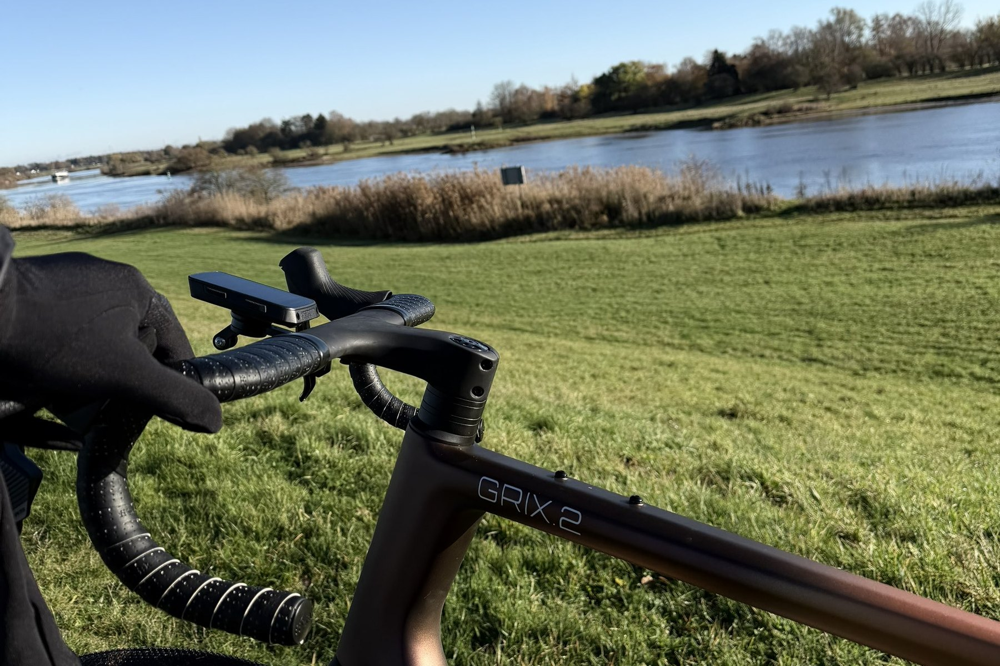
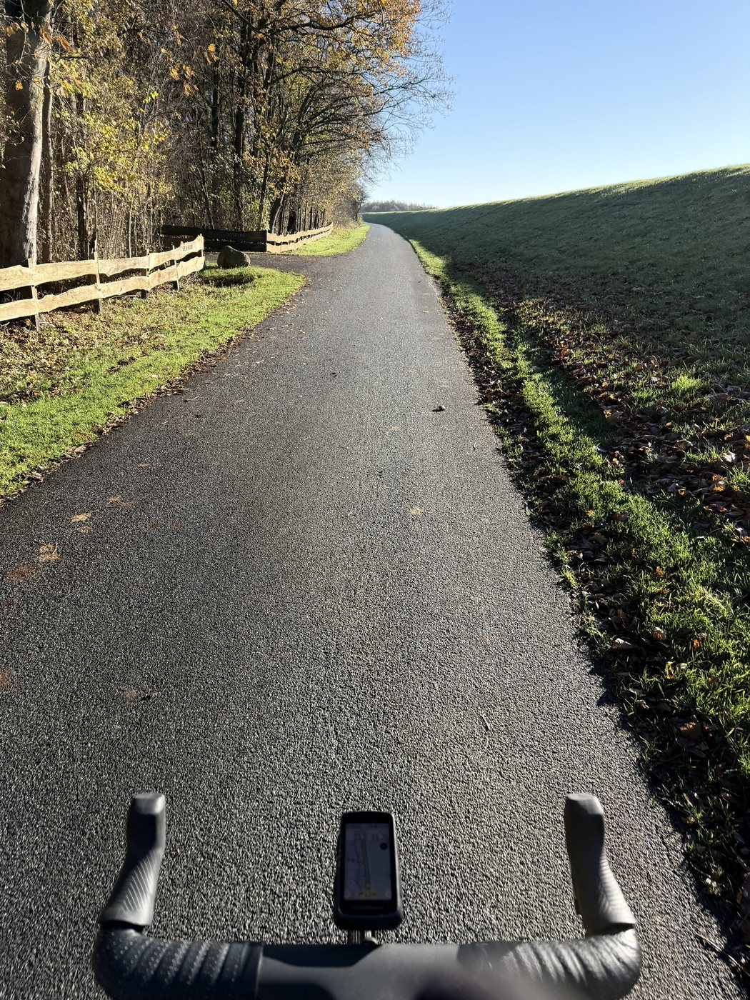

Seit dem 18. November steht ein zweites Gravelbike im Flur. Ein Storck Grix.2 Pro, Carbon, Rahmengröße L, mit einem kupferfarbenen Verlauf, der am Deich fast zu schön aussieht. Das Canyon Grizl bleibt trotzdem. Es hat jetzt nur einen klareren Job.

## Warum das Storck

Ich fahre am liebsten Asphalt, Schotter und Waldwege, und das gern zügig. Ein Ziel habe ich mir dafür gesetzt: 50 Kilometer unter zwei Stunden. Dafür wollte ich ein Rad, das leicht ist, direkt reagiert und auf langen Strecken nicht nervt.

Die Schaltung war eine bewusste Entscheidung. SRAM Rival AXS mit einem Kettenblatt und zwölf Ritzeln, komplett kabellos. Keine Schaltzüge, die sich längen. Die Akkus nimmt man ab und lädt sie, fertig. Und ein Umwerfer fehlt mir in Bremen nicht. Bei uns braucht man die Gänge eher gegen den Wind als gegen den Berg.

Dazu kommen Laufräder von DT Swiss und Schwalbe G-One Allround, die ich direkt auf tubeless umgerüstet habe. An den Pedalen hat sich wenig geändert: SPD wie seit Jahren, am Storck jetzt die Shimano XT. Der Karoo 3 hat ein eigenes Profil „Gravel“ für dieses Rad bekommen.

Bevor es richtig losging, war ich beim professionellen Bikefitting. Die Empfehlung danach war angenehm unspektakulär: erst einmal eine Weile mit dem neuen Setup fahren.

## Storck und Grizl: zwei Räder, zwei Jobs

Das Grizl ist ein Canyon Grizl aus Aluminium, Rahmengröße XL, rund 11 Kilo. Mit ihm pendle ich fast jeden Tag zur Arbeit, knapp 20 Kilometer hin und zurück, mit Packtasche. Den Vorbau habe ich von 90 auf 70 Millimeter gekürzt. Drauf sind Continental Terra Competition mit 45 Millimetern.

**Was das Grizl gut kann**

- Es ist robust. Aluminium verzeiht Kratzer, Fahrradständer und nasse Tage.
- Es nimmt Gepäck mit, ohne zu meckern. Reichlich Ösen für Träger und Taschen, laut Canyon Platz für Reifen bis 50 Millimeter.
- Es läuft ruhig. Canyon baut das Grizl mit langem Radstand, das macht es auf Schotter gutmütig.

**Was das Storck anders macht**

- Der Carbonrahmen ist deutlich leichter. Storck gibt für den Grix.2-Rahmen ab rund 900 Gramm an, Canyon für den Grizl-Aluminiumrahmen 1.620 Gramm.
- Es ist sportlicher gebaut. Kurzes Steuerrohr, integriertes Cockpit, Rohrformen fast wie bei einem Aero-Rennrad.
- Es schaltet elektronisch und ohne Kabel. Am Grizl schaltet eine mechanische Shimano CUES.

Kurz gesagt: Das Grizl ist das Rad für den Alltag, das Storck das für die langen Tage. Wer eins von beiden sucht, sollte sich vor allem eine Frage stellen: Fahre ich jeden Tag mit Gepäck, oder will ich am Wochenende Strecke machen?

Die erste Runde mit dem Storck steht übrigens bei den [Touren](/touren/erste-runde-storck/). 52 Kilometer, 158 Höhenmeter. Bremer Normalprogramm.
