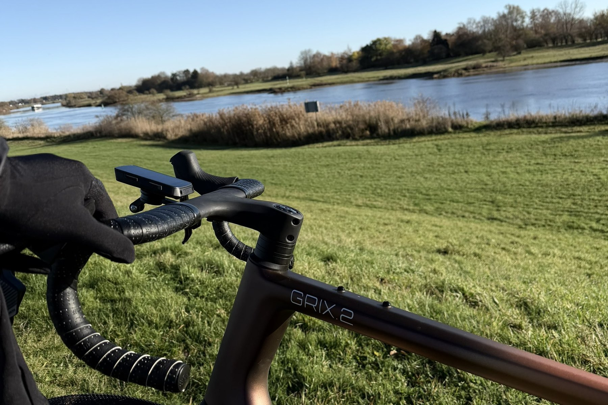
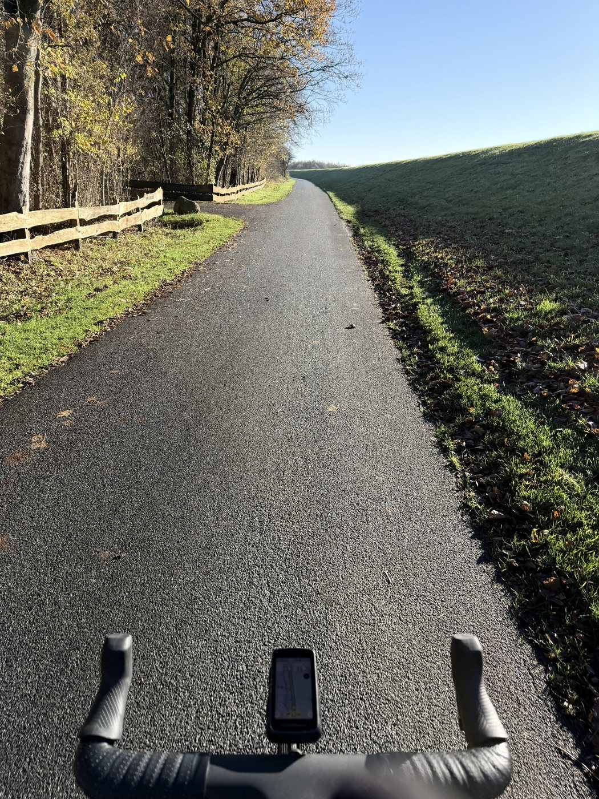

Since 18 November a second gravel bike has been standing in the hallway. A Storck Grix.2 Pro, carbon, frame size L, with a copper fade that looks almost too good for the dyke. The Canyon Grizl stays. It just has a clearer job now.

## Why the Storck

I like riding tarmac, gravel and forest tracks most, and I like riding them briskly. I set myself one goal for that: 50 kilometres in under two hours. So I wanted a bike that is light, responds directly and doesn't get on my nerves over long distances.

The groupset was a deliberate choice. SRAM Rival AXS with one chainring and twelve sprockets, fully wireless. No gear cables that stretch. You take the batteries off and charge them, done. And I don't miss a front derailleur in Bremen. Here you need the gears for the wind rather than for the hills.

Add DT Swiss wheels and Schwalbe G-One Allround tyres, which I converted to tubeless straight away. Not much changed at the pedals: SPD as for years, now Shimano XT on the Storck. The Karoo 3 got its own “Gravel” profile for this bike.

Before riding it properly, I went for a professional bike fit. The advice afterwards was pleasantly unspectacular: ride the new setup for a while first.

## Storck and Grizl: two bikes, two jobs

The Grizl is a Canyon Grizl in aluminium, frame size XL, around 11 kilos. I commute on it almost every day, just under 20 kilometres there and back, with a pannier. I shortened the stem from 90 to 70 millimetres. It runs Continental Terra Competition tyres in 45 millimetres.

**What the Grizl does well**

- It is tough. Aluminium forgives scratches, bike racks and wet days.
- It carries luggage without complaining. Plenty of mounts for racks and bags, and according to Canyon room for tyres up to 50 millimetres.
- It rides calmly. Canyon builds the Grizl with a long wheelbase, which makes it good-natured on gravel.

**What the Storck does differently**

- The carbon frame is much lighter. Storck quotes around 900 grams for the Grix.2 frame, Canyon 1,620 grams for the aluminium Grizl frame.
- It is built sportier. Short head tube, integrated cockpit, tube shapes almost like an aero road bike.
- It shifts electronically and without cables. On the Grizl a mechanical Shimano CUES does the shifting.

In short: the Grizl is the everyday bike, the Storck the one for long days. If you are looking for one of the two, ask yourself one question above all: do I ride every day with luggage, or do I want to cover distance at the weekend?

By the way, the first ride on the Storck is in the [rides](/en/touren/erste-runde-storck/). 52 kilometres, 158 metres of climbing. The usual Bremen programme.
